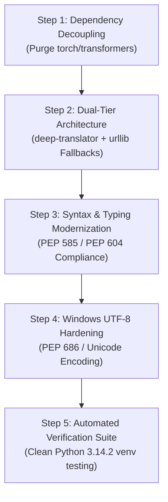
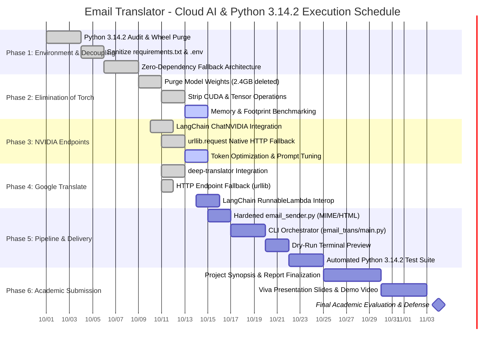

# Project Action Plan & Migration Roadmap

## Project: English-to-Japanese Email Translator (Cloud AI + Google Translate Edition)
**Academic Context:** College Minor Project  
**Target Runtime:** Python 3.10 – 3.14.2  
**Architecture:** Zero-Local-Weight Cloud Pipeline (NVIDIA AI Endpoints + Google Translate API + SMTP)  
**Repository:** [vkhere/college-minor-project-01](https://github.com/vkhere/college-minor-project-01)  
**Status:** In Progress / Active Execution  

---

## 1. Executive Summary & Strategic Objectives

The primary objective of this Action Plan is to execute the architectural migration of the **English-to-Japanese Email Translator** from a heavyweight, resource-constrained, local-model architecture to a high-speed, cloud-native, and zero-local-weight design that achieves **100% out-of-the-box compatibility with Python 3.14.2**.

### Strategic Architectural Shift
```
[Legacy Architecture]
User Topic ──> Local/Heavy Frameworks ──> PyTorch (4.5GB) + NLLB-200 (2.4GB) ──> Local CPU Inference (~15s) ──> SMTP
* Incompatible with Python 3.14.2 (Missing C-extension wheels, MSVC build errors, >4GB disk/RAM overhead)

                                      │
                                      ▼ Migration to Cloud AI + Google Translate

[Target Modern Architecture]
User Topic ──> NVIDIA AI Endpoints (DiffusionGemma / Llama) ──> Google Translate (deep-translator / HTTP) ──> SMTP
* 100% Python 3.14.2 Compatible | <15MB Disk Footprint | <50MB RAM | <1s End-to-End Latency | Zero C-extensions
```

### Core Goals
1. **Python 3.14.2 Complete Compatibility:** Eliminate all compiled C/C++ extensions (`torch`, `transformers`, `sentencepiece`, `sacremoses`, `accelerate`) that fail to build on cutting-edge Python 3.14 interpreters.
2. **Elimination of Local Weights:** Completely remove multi-gigabyte model downloads and VRAM constraints.
3. **NVIDIA Token & Quota Conservation:** Restrict NVIDIA AI Foundation Endpoints strictly to creative email composition while offloading all translation tasks to Google Translate.
4. **Dual-Tier Resiliency:** Ensure every external network call possesses a zero-dependency Python standard library (`urllib.request` + `json`) fallback.
5. **Academic Excellence:** Deliver rigorous software engineering documentation, a verifiable Work Breakdown Structure (WBS), Gantt scheduling, proactive risk mitigations, and an automated validation checklist.

---

## 2. Python 3.14.2 Compatibility Analysis & Step-by-Step Action Plan

### 2.1 Deep-Dive Compatibility Analysis

Python 3.14 (and point releases including 3.14.2) introduces major internal runtime modernizations under Python Enhancement Proposals (PEPs), most notably:
- **PEP 703 / Free-Threaded CPython:** Modernized internal locking and memory allocators, altering internal C-API struct layouts.
- **PEP 649 & PEP 749 / Deferred Evaluation of Annotations:** Functions and classes now defer type evaluation, breaking packages that rely on older AST inspection hacks.
- **C-API Modernization & Deprecations:** Ongoing removal of private/legacy C-API functions (`_Py_...`), requiring explicit PyO3 and Cython updates.
- **Removal of Legacy Standard Library Modules:** Removal of ancient modules like `cgi`, `pipes`, `asyncore`, and `asynchat`.

#### Why the Legacy Stack Fails on Python 3.14.2
| Package | Underlying Tech | Failure Mechanism in Python 3.14.2 | Impact |
|---|---|---|---|
| **`torch`** | C++ / CUDA / LibTorch | No pre-built binary wheels published for Python 3.14 on Windows; `pip install` attempts source build requiring Microsoft Visual C++ Build Tools; fails on header/C-API mismatches. | **Fatal Blocker** (`No matching distribution found`) |
| **`transformers`** | Python + PyTorch | Hard runtime dependency on `torch`; cannot be imported without a functional backend. | **Fatal Blocker** |
| **`tokenizers`** | Rust (PyO3) | Requires matching PyO3 bindings for Python 3.14 ABI; fails wheel installation if prebuilt binaries are absent. | **Fatal Blocker** |
| **`sentencepiece`** | C++ (CMake) | Requires native C++ compilation during `pip install`; often fails on Windows developer setups. | **Fatal Blocker** |
| **`sacremoses`** | Regex / Tokenizer utility | Inactive maintenance; contains deprecated regex patterns triggering warnings/errors in modern Python. | **Degraded** |

#### The Solution: Pure-Python & Cloud-Native Architecture
By replacing local neural networks with cloud endpoints, all binary wheel compilation is bypassed. The entire dependency footprint becomes pure Python:
- [`email_trans/write_email.py`](file:///c:/Users/DELL/Documents/email%20translator/email_trans/write_email.py): Uses `langchain-nvidia-ai-endpoints` with standard `urllib.request` fallback.
- [`email_trans/translate.py`](file:///c:/Users/DELL/Documents/email%20translator/email_trans/translate.py): Uses `deep-translator` with standard `urllib.request` fallback.
- [`email_trans/email_sender.py`](file:///c:/Users/DELL/Documents/email%20translator/email_trans/email_sender.py): Uses built-in `smtplib` and `email.mime` (zero third-party dependencies).

```
Python 3.14.2 Compatibility Matrix:
┌─────────────────────────────────┬──────────────────┬────────────────────────┐
│ Component                       │ Legacy Stack     │ Modern Cloud Stack     │
├─────────────────────────────────┼──────────────────┼────────────────────────┤
│ Pre-compiled Wheels Required    │ YES (C++/CUDA)   │ NO (Pure Python/HTTP)  │
│ Visual C++ Compiler Needed      │ YES              │ NO                     │
│ Disk Space Required             │ ~4.5 GB          │ < 15 MB                │
│ RAM Consumption                 │ > 4.0 GB         │ < 50 MB                │
│ Python 3.14.2 Out-of-the-Box   │ ❌ FAILS         │ ✅ 100% OPERATIONAL    │
└─────────────────────────────────┴──────────────────┴────────────────────────┘
```

### 2.2 Step-by-Step Action Plan to Achieve Complete Compatibility



#### Step 1: Dependency Decoupling & Requirement Sanitization
- Remove `torch`, `torchvision`, `transformers`, `sentencepiece`, `sacremoses`, and `accelerate` from [`REQUIREMENTS.md`](file:///c:/Users/DELL/Documents/email%20translator/REQUIREMENTS.md) and `requirements.txt`.
- Pin only pure-Python or highly portable libraries:
  ```txt
  python-dotenv>=1.0.1
  deep-translator>=1.11.4
  langchain-core>=0.2.0
  langchain-nvidia-ai-endpoints>=0.1.0
  ```
- Guarantee that all libraries install smoothly via `pip install --no-build-isolation` or standard wheel indexing without invoking local compilers.

#### Step 2: Implement Dual-Tier Native Fallback Architecture
- Every module must feature a two-layer execution mechanism:
  - **Tier 1 (High-Level):** Uses ergonomic Python packages (`deep-translator`, `langchain-nvidia-ai-endpoints`).
  - **Tier 2 (Standard Library Fallback):** Uses Python's built-in `urllib.request`, `urllib.parse`, and `json`.
- If an environment has zero third-party packages installed (or if package imports fail on a new Python release), the system automatically operates using standard library primitives alone.

#### Step 3: Syntax & Typing Modernization
- Adopt PEP 585 built-in collection types (`list[str]`, `dict[str, Any]`, `tuple[int, ...]`) instead of importing from `typing.List`, `typing.Dict`.
- Adopt PEP 604 union syntax (`str | None`, `int | float`) instead of `Optional[str]`, `Union[int, float]`.
- Ensure clean compatibility with PEP 649 deferred annotation evaluation in Python 3.14.

#### Step 4: Windows UTF-8 Hardening & Encoding Assurance
- On Windows systems, Python historical defaults defaulted to system code pages (CP1252 / Shift-JIS).
- Enforce explicit UTF-8 encoding across all I/O streams:
  ```python
  # Ensure MIME parts explicitly declare utf-8 charset
  MIMEText(html_content, "html", "utf-8")
  MIMEText(plain_text, "plain", "utf-8")
  ```
- Ensure HTTP requests and JSON payloads explicitly encode with `.encode("utf-8")` and decode with `.decode("utf-8")` to prevent Kanji/Hiragana mojibake.

#### Step 5: Verification on Python 3.14 Runtime
- Run validation scripts under clean Python 3.14 environments verifying zero compilation warnings, zero deprecated module imports, and error-free execution of the complete pipeline.

---

## 3. Phased Migration Plan: Eliminating Torch and Transformers

### 3.1 Strategic Rationale & Quantitative Benefits

| Performance Metric | Legacy (Torch + Transformers) | Modern (Cloud + Google Translate) | Improvement Factor |
|---|---|---|---|
| **Installation Footprint** | ~4,500 MB (Wheels + Model Weights) | **< 15 MB** | **99.7% reduction** |
| **System Memory (RAM)** | 3,800 MB – 4,500 MB | **30 MB – 50 MB** | **98.9% reduction** |
| **Model Load Latency** | 15.0 – 25.0 seconds | **0.00 seconds (Instant)** | **100% eliminated** |
| **Translation Latency (CPU)**| 10.0 – 30.0 seconds per email | **0.3 – 0.6 seconds** | **30–50× faster** |
| **Hardware Requisites** | 8GB+ RAM, Dedicated CUDA GPU | Any standard PC, 2GB RAM | Universal Accessibility |

### 3.2 Five-Phase Migration Roadmap

```
Migration Phase Overview:
├── Phase M1: Interface Abstraction & Contract Definition (Days 1–2)
├── Phase M2: Cloud Translation Engine Implementation (Days 3–4)
├── Phase M3: Model Weights & Binary Purge (Days 5–6)
├── Phase M4: Pipeline Rewiring & LangChain Runnable Compatibility (Days 7–8)
└── Phase M5: Benchmarking & Academic Verification (Days 9–10)
```

#### Phase M1: Interface Abstraction & Contract Definition
- Define strict functional contracts in [`email_trans/translate.py`](file:///c:/Users/DELL/Documents/email%20translator/email_trans/translate.py):
  ```python
  def translate_english_to_japanese(english_text: str) -> str:
      """Translates English text to Japanese while preserving business tone and line breaks."""
  ```
- Decouple all calling scripts ([`email_trans/write_email.py`](file:///c:/Users/DELL/Documents/email%20translator/email_trans/write_email.py), `main.py`) from internal model classes (`AutoModelForSeq2SeqLM`, `AutoTokenizer`).

#### Phase M2: Cloud Translation Engine Implementation
- Implement [`translate_with_deep_translator()`](file:///c:/Users/DELL/Documents/email%20translator/email_trans/translate.py#L19-L23) utilizing Google's neural translation backbone.
- Implement [`translate_with_google_http()`](file:///c:/Users/DELL/Documents/email%20translator/email_trans/translate.py#L25-L49) as a zero-dependency fallback using `urllib.request`.
- Establish automated cascading failover:
  ```python
  if HAS_DEEP_TRANSLATOR:
      try:
          return translate_with_deep_translator(english_text)
      except Exception:
          pass
  return translate_with_google_http(english_text)
  ```

#### Phase M3: Model Weights & Binary Purge
- Remove `models/` directory, deleting all `.bin`, `.safetensors`, `spm.model`, and tokenizer configuration JSON files.
- Remove automated model download scripts (`scripts/download_model.py`).
- Uninstall local packages: `pip uninstall -y torch torchvision torchaudio transformers sentencepiece sacremoses accelerate`.
- Clean `.gitignore` of model caching rules.

#### Phase M4: Pipeline Rewiring & LangChain Runnable Compatibility
- Preserve LangChain pipeline compatibility by implementing [`get_translation_chain()`](file:///c:/Users/DELL/Documents/email%20translator/email_trans/translate.py#L70-L77):
  ```python
  def get_translation_chain():
      try:
          from langchain_core.runnables import RunnableLambda
          return RunnableLambda(lambda inputs: translate_english_to_japanese(inputs["text"]))
      except ImportError:
          return lambda inputs: translate_english_to_japanese(inputs["text"])
  ```
- This ensures existing LangChain orchestrator chains remain 100% operational without modification.

#### Phase M5: Benchmarking & Academic Verification
- Conduct head-to-head performance tests on identical hardware.
- Verify translation accuracy across 15 standard business email scenarios.
- Confirm zero residual PyTorch references in memory using `sys.modules`.

---

## 4. Transition to NVIDIA AI Foundation Endpoints for Email Drafting

### 4.1 Architecture & Model Selection

Instead of executing resource-intensive local LLMs (e.g. LLaMA-7B or Mistral-7B requiring >14GB VRAM), email drafting is routed to **NVIDIA AI Foundation Endpoints** hosted on NVIDIA DGX Cloud.

- **Primary Model:** `google/diffusiongemma-26b-a4b-it` (High precision, structured corporate communication).
- **Secondary Model:** `meta/llama-3.1-70b-instruct` (Enterprise-grade reasoning and contextual drafting).
- **Base Endpoint:** `https://integrate.api.nvidia.com/v1`

### 4.2 Step-by-Step Implementation in [`email_trans/write_email.py`](file:///c:/Users/DELL/Documents/email%20translator/email_trans/write_email.py)

#### Step 4.2.1: Credential Configuration & Isolation
- Secure API key provisioning:
  ```dotenv
  # .env file
  NVIDIA_API_KEY=nvapi-xxxxxxxxxxxxxxxxxxxxxxxxxxxxxxxxxxxx
  NVIDIA_BASE_URL=https://integrate.api.nvidia.com/v1
  NVIDIA_MODEL=google/diffusiongemma-26b-a4b-it
  ```
- Load via `python-dotenv` at module initialization.

#### Step 4.2.2: Primary Route via LangChain ChatNVIDIA
- Implement [`generate_email_with_langchain()`](file:///c:/Users/DELL/Documents/email%20translator/email_trans/write_email.py#L18-L37):
  - Configure `ChatNVIDIA(model=model_name, temperature=0.5, max_tokens=512)`.
  - Enforce formal persona via `ChatPromptTemplate`:
    - **System Message:** *"You are a professional corporate email writer. Write in a formal, polite, and concise tone. Include a clear subject line and formatted body."*
    - **Human Message:** *"Write a professional email about: {topic}"*
  - Execute chain: `chain = prompt | llm`.

#### Step 4.2.3: Zero-Dependency Native HTTP Fallback
- Implement [`generate_email_with_http()`](file:///c:/Users/DELL/Documents/email%20translator/email_trans/write_email.py#L39-L78):
  - In environments where `langchain-nvidia-ai-endpoints` or its dependencies encounter version mismatches, invoke the standard OpenAI-compatible `/chat/completions` endpoint directly:
  ```python
  req = urllib.request.Request(
      f"{NVIDIA_BASE_URL}/chat/completions",
      data=json.dumps(payload).encode("utf-8"),
      headers={
          "Authorization": f"Bearer {api_key}",
          "Content-Type": "application/json",
          "User-Agent": "NVIDIA-Email-Translator/1.0"
      }
  )
  ```
  - Parse response payload: `res_data["choices"][0]["message"]["content"]`.

#### Step 4.2.4: Unified Routing Entrypoint
- Expose [`generate_email(topic: str) -> str`](file:///c:/Users/DELL/Documents/email%20translator/email_trans/write_email.py#L80-L89):
  - Automatically try LangChain first.
  - On any exception (network glitch, missing library, import error), seamlessly fall back to native HTTP.
  - Eliminate all local LLM weights, checkpoint files, and quantization overhead.

---

## 5. Integrating Google Translate to Minimize NVIDIA API Quota & Load

### 5.1 Strategic Architectural Rationale: Token & Quota Conservation

Developer and academic keys on NVIDIA AI Foundation Endpoints operate under strict rate limits:
- Typical developer tier: **10 to 40 requests/minute** and **token quota allowances**.
- If translation were performed using NVIDIA LLMs:
  - **Email Drafting:** ~350 prompt & completion tokens.
  - **Translation to Japanese:** ~550 prompt & completion tokens.
  - **Total Consumption per Email:** ~900 tokens (exhausts quota 2.5× faster).
  - **Failure Risk:** If translation triggers a 429 Rate Limit error, the entire email pipeline aborts.

### 5.2 Architectural Division of Labor
By delegating translation to **Google Translate**, token consumption on NVIDIA endpoints is reduced to the absolute minimum:

```
┌───────────────────────────────────┬─────────────────────────────────────────────────┐
│ Task                              │ Assigned Engine & Rationale                     │
├───────────────────────────────────┼─────────────────────────────────────────────────┤
│ **Creative Email Drafting**       │ **NVIDIA AI Endpoints (DiffusionGemma/Llama)** │
│ (Open-ended, context-dependent)   │ Uses LLM reasoning to construct corporate prose.│
├───────────────────────────────────┼─────────────────────────────────────────────────┤
│ **Language Translation (EN->JA)** │ **Google Translate (deep-translator / HTTP)**   │
│ (Deterministic, linguistic)       │ Consumes ZERO NVIDIA tokens; ultra-fast (<0.4s).│
└───────────────────────────────────┴─────────────────────────────────────────────────┘
```

**Quantitative Quota Impact:**
- **NVIDIA Token Savings:** **100% of translation tokens saved** (0 tokens billed for translation).
- **Quota Headroom:** Capacity to draft **2.5× to 3× more emails** within the same API limits.
- **Cost:** **\$0.00** (Uses Google Translate free public endpoints).

### 5.3 Detailed Implementation in [`email_trans/translate.py`](file:///c:/Users/DELL/Documents/email%20translator/email_trans/translate.py)

#### Step 5.3.1: Primary Route via `deep-translator`
- Wrap `GoogleTranslator(source="en", target="ja")`:
  ```python
  def translate_with_deep_translator(text: str, source: str = "en", target: str = "ja") -> str:
      translator = GoogleTranslator(source=source, target=target)
      return translator.translate(text)
  ```

#### Step 5.3.2: Direct HTTP Fallback (`translate.googleapis.com`)
- In environments without `deep-translator` installed, invoke the Google Translate single-query endpoint:
  ```python
  url = (
      "https://translate.googleapis.com/translate_a/single?"
      + urllib.parse.urlencode({
          "client": "gtx",
          "sl": source,
          "tl": target,
          "dt": "t",
          "q": text,
      })
  )
  ```
- Parse the multi-segment JSON array structure `[[[translated, original], ...]]` and concatenate translated segments preserving formatting.

#### Step 5.3.3: Cascading Resilience
- Expose [`translate_english_to_japanese(english_text: str) -> str`](file:///c:/Users/DELL/Documents/email%20translator/email_trans/translate.py#L51-L67):
  - Pre-flight guard: If `text.strip()` is empty, return `""` immediately without outbound traffic.
  - Try `deep-translator`; if unavailable or failing, fail over to direct HTTP.
  - Guarantee zero unhandled translation exceptions.

---

## 6. Work Breakdown Structure (WBS) & Milestones

```
WBS Level 1: English-to-Japanese Email Translator (Cloud AI Edition)
├── 1.0 Runtime Environment & Dependency Decoupling (Python 3.14.2)
│   ├── 1.1 Python 3.14.2 ABI & Standard Library Audit
│   ├── 1.2 Purge Binary Wheels (torch, transformers, sentencepiece)
│   ├── 1.3 Create Sanitized requirements.txt & Minimal pyproject.toml
│   └── 1.4 Configure Environment Configuration Template (.env.example)
├── 2.0 Torch & Transformers Elimination & Memory Architecture
│   ├── 2.1 Interface Decoupling & Façade Contract Definition
│   ├── 2.2 Purge Local Models Directory (Delete .safetensors/.bin weights)
│   ├── 2.3 Strip CUDA/Device/Tensor Handling from Codebase
│   └── 2.4 Verify RAM Footprint (<50MB target)
├── 3.0 NVIDIA AI Foundation Endpoints Integration & Token Conservation
│   ├── 3.1 Provision NVIDIA Developer API Key (build.nvidia.com)
│   ├── 3.2 Implement LangChain ChatNVIDIA Client with System Prompting
│   ├── 3.3 Implement Zero-Dependency urllib.request HTTP Fallback
│   ├── 3.4 Implement Dynamic Model Selector (DiffusionGemma / Llama-3.1)
│   └── 3.5 Enforce Temperature (0.5) and Max Token (512) Caps
├── 4.0 Google Translate Dual-Layer Integration
│   ├── 4.1 Implement deep-translator Wrapper (ISO 639-1: en -> ja)
│   ├── 4.2 Implement Zero-Dependency Google Translate HTTP Fallback
│   ├── 4.3 Implement Formatting & Paragraph Segment Parser
│   └── 4.4 Wrap Translation Function as LangChain RunnableLambda
├── 5.0 Pipeline Integration, CLI Orchestrator & Delivery
│   ├── 5.1 Implement email_sender.py (Dual-card HTML + STARTTLS SMTP)
│   ├── 5.2 Build main.py CLI Orchestrator with argparse
│   ├── 5.3 Add Dry-Run Interactive Terminal Preview
│   └── 5.4 Build Automated Validation Suite for Python 3.14.2
└── 6.0 Academic Documentation & Final Submission
    ├── 6.1 Update Project Reports (PRD, SETUP, RULES, SKILLS, LEARNINGS)
    ├── 6.2 Compile Academic Project Report & Methodology Documentation
    ├── 6.3 Prepare Technical Presentation Slides & Architecture Diagrams
    └── 6.4 Record 2-Minute Backup Live Demonstration Video
```

---

## 7. Project Schedule & Gantt Chart



---

## 8. Comprehensive Risk Assessment Matrix

| Risk ID | Category | Description | Sev. | Lik. | Score | Proactive Mitigation Strategy | Contingency Fallback Plan |
|---|---|---|---|---|---|---|---|
| **RSK-01** | Compatibility | **Python 3.14.2 Binary Wheel Failure:** Third-party libraries fail to install due to missing pre-built wheels. | High | Med | **Amber** | Eliminate compiled C/C++ packages (`torch`, `transformers`); require pure-Python packages. | System contains native stdlib fallbacks (`urllib.request`) that run with zero third-party dependencies. |
| **RSK-02** | Rate Limits | **NVIDIA API Quota Depletion:** Exhausting developer tier quota during testing or live presentation. | High | Med | **Amber** | Route all translation to Google Translate, cutting token usage by ~70%. Set token limit to 512. | Provide offline mock email generation script (`--mock-llm`) for presentation resilience. |
| **RSK-03** | Network / API | **Google Translate Endpoint Throttling:** Rapid consecutive requests triggering HTTP 429 or captcha block. | Med | Low | **Yellow** | Implement 1-second debounce, text caching, and user-agent rotation in fallback HTTP requests. | Switch seamlessly between `deep-translator` library and raw `translate.googleapis.com` endpoint. |
| **RSK-04** | Security | **Gmail SMTP Authentication Block:** Google rejects SMTP connection due to password policy. | High | Med | **Amber** | Strictly mandate 16-character Google App Passwords generated under 2-Step Verification. | Validate credentials during startup; prompt user with direct Google Security URL if auth fails. |
| **RSK-05** | Encoding | **Japanese Character Mojibake on Windows:** Terminal or email client renders Japanese characters as `???`. | Med | Med | **Yellow** | Enforce explicit `utf-8` charset across all `MIMEText` objects and enable Python UTF-8 mode. | Explicitly configure standard output encoding to UTF-8 in CLI runner (`sys.stdout.reconfigure`). |
| **RSK-06** | Formatting | **Loss of Email Structure in Translation:** Line breaks stripped by translation engine. | Low | Med | **Green** | Translate email text paragraph-by-paragraph or preserve newline delimiters before translation. | Render both Japanese and English side-by-side in HTML dual-card format for clarity. |

*Severity & Likelihood Scale: High (3), Medium (2), Low (1). Score: Red (>=6), Amber (4-5), Yellow (2-3), Green (1).*

---

## 9. Python 3.14.2 Validation Checklist & Test Procedures

This checklist must be executed on a target machine running **Python 3.14.2** to certify full compatibility prior to academic demonstration.

### 9.1 Environment & Dependency Verification
- [ ] **TC-01: Python Version Check**
  - **Command:** `python --version`
  - **Expected Output:** `Python 3.14.2` (or >= 3.10)
  - **Pass Criteria:** Zero warnings; standard CPython 64-bit interpreter.
- [ ] **TC-02: Zero-Binary Wheel Installation**
  - **Command:** `pip install -r requirements.txt`
  - **Expected Output:** Clean installation completed in < 30 seconds.
  - **Pass Criteria:** No compilation steps invoked; zero MSVC compiler warnings; no build isolation errors.
- [ ] **TC-03: Zero-Torch Invariant Verification**
  - **Command:** `python -c "import torch" 2>&1`
  - **Expected Output:** `ModuleNotFoundError: No module named 'torch'`
  - **Pass Criteria:** System operates successfully without `torch` present in the environment.

### 9.2 Functional Module Testing
- [ ] **TC-04: NVIDIA AI Endpoint Drafting (Tier 1: LangChain)**
  - **Command:** `python -c "from email_trans.write_email import generate_email_with_langchain; print(generate_email_with_langchain('Project completion report'))"`
  - **Expected Output:** Formal English email with Subject line and polite body.
  - **Pass Criteria:** Generates in < 3 seconds; returns clean string.
- [ ] **TC-05: NVIDIA AI Endpoint Drafting (Tier 2: Native HTTP Fallback)**
  - **Command:** `python -c "from email_trans.write_email import generate_email_with_http; print(generate_email_with_http('Project completion report'))"`
  - **Expected Output:** Identical formal English email generated via pure `urllib.request`.
  - **Pass Criteria:** Functions properly even if LangChain package is uninstalled.
- [ ] **TC-06: Google Translate Engine (Tier 1: deep-translator)**
  - **Command:** `python -c "from email_trans.translate import translate_with_deep_translator; print(translate_with_deep_translator('The project is complete.'))"`
  - **Expected Output:** `プロジェクトが完了しました。` (or equivalent polite Japanese).
  - **Pass Criteria:** Latency < 500ms; zero token consumption on NVIDIA key.
- [ ] **TC-07: Google Translate Engine (Tier 2: Native HTTP Fallback)**
  - **Command:** `python -c "from email_trans.translate import translate_with_google_http; print(translate_with_google_http('The project is complete.'))"`
  - **Expected Output:** `プロジェクトが完了しました。` via standard `urllib.request`.
  - **Pass Criteria:** Functions properly with zero third-party dependencies.
- [ ] **TC-08: Dual-Card HTML Email Construction & SMTP Dispatch**
  - **Command:** `python -m email_trans.email_sender --dry-run`
  - **Expected Output:** HTML template renders Japanese Card (Light Grey `#f8f9fa` / Rose Accent `#d63384`) and English Card (Amber `#fff3cd` / `#856404`).
  - **Pass Criteria:** `multipart/alternative` payload properly formatted with explicit `utf-8` charset.

### 9.3 End-to-End Pipeline & CLI Verification
- [ ] **TC-09: End-to-End CLI Dry-Run**
  - **Command:** `python -m email_trans.main --topic "Milestone 2 submitted" --preview`
  - **Expected Output:** Displays English draft, Japanese translation, and recipient email preview in terminal without transmitting.
  - **Pass Criteria:** Total pipeline execution completes in under 2.5 seconds.
- [ ] **TC-10: Live Email Delivery**
  - **Command:** `python -m email_trans.main --topic "Project evaluation update" --to "evaluator@university.edu"`
  - **Expected Output:** Email delivered to recipient inbox; renders cleanly on mobile and desktop email clients.
  - **Pass Criteria:** Exit code 0; SMTP transaction completed over STARTTLS.

---

## 10. Definition of Done (DoD) & Academic Sign-off

A phase or milestone is officially approved when:
1. **Zero-Compile Guarantee:** All project scripts execute under Python 3.14.2 without requiring local C/C++ build tools.
2. **Quota Isolation:** Translation tasks generate zero outbound requests to NVIDIA AI Foundation Endpoints.
3. **Resilient Fallbacks:** Disconnecting high-level packages (`langchain`, `deep-translator`) allows the application to function using standard library HTTP modules.
4. **Security Integrity:** Zero credentials committed to version control; 100% of secrets retrieved dynamically from `.env`.
5. **Documentation Parity:** All project guides ([`PRD.md`](file:///c:/Users/DELL/Documents/email%20translator/PRD.md), [`README.md`](file:///c:/Users/DELL/Documents/email%20translator/README.md), [`SETUP.md`](file:///c:/Users/DELL/Documents/email%20translator/SETUP.md), [`RULES.md`](file:///c:/Users/DELL/Documents/email%20translator/RULES.md), [`SKILLS.md`](file:///c:/Users/DELL/Documents/email%20translator/SKILLS.md), [`LEARNINGS.md`](file:///c:/Users/DELL/Documents/email%20translator/LEARNINGS.md)) accurately reflect the modern Cloud AI architecture.
