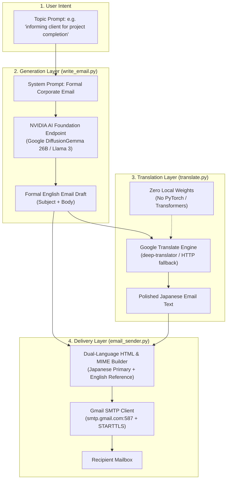

# Product Requirements Document (PRD)

## Project: English-to-Japanese Email Translator
**Type:** College Minor Project  
**Version:** 1.0.0 (Cloud-Native Architecture)  
**Status:** In Progress / Prototyping  
**Author / Team:** Devendra Kumar & Team  
**Repository:** [vkhere/college-minor-project-01](https://github.com/vkhere/college-minor-project-01)  

---

## 1. Executive Summary

In global business and academia, cross-border correspondence between English speakers and Japanese clients or institutions poses distinct challenges. Japanese business communication adheres to strict conventions of formality, tone, and etiquette (Keigo / 敬語). 

The **English-to-Japanese Email Translator** is an automated, end-to-end communication assistant that:
1. **Generates** professionally styled formal business emails from simple bullet-point topics using cloud-hosted generative Large Language Models via NVIDIA AI Foundation Endpoints (supporting Google DiffusionGemma 26B and Meta Llama 3 / Llama 3.1).
2. **Translates** the generated English email into Japanese using Google Translate (via `deep-translator` with direct HTTP fallback), completely eliminating local PyTorch/Transformers dependencies and multi-gigabyte local model checkpoints.
3. **Dispatches** the email directly via a secure Gmail SMTP client, delivering a polished dual-language HTML email that highlights the Japanese translation as primary communication while embedding the original English text for verification.

---

## 2. Problem Statement

### 2.1 The Challenge
- **Linguistic and Cultural Barriers:** Japanese business culture relies heavily on structured formal phrasing, honorifics, and polite greetings. Literal translations from generic tools often appear abrasive or awkward.
- **Time Inefficiency:** Drafting formal correspondence and finding accurate domain translations requires substantial manual effort or costly translation services.
- **Context Loss:** When non-native speakers send emails translated through ordinary translators, the recipient has no easy access to the source message to resolve ambiguous idioms or domain-specific terms.
- **Local Compute & Storage Bottlenecks (Legacy Architecture):** Traditional local Neural Machine Translation approaches (e.g., Meta NLLB-200 Seq2Seq running via PyTorch and Hugging Face Transformers) impose severe operational constraints:
  - **High Storage Footprint:** Requiring 2.5 GB to 4+ GB of downloaded model weights and heavy library wheels.
  - **Memory & Hardware Demands:** Consuming 4+ GB of RAM and causing high CPU latency without a dedicated CUDA GPU.
  - **Runtime & Ecosystem Incompatibilities:** Tight dependency on PyTorch and C-extensions causes broken installations and build failures on modern Python environments like **Python 3.14.2**.

### 2.2 The Solution
An integrated, lightweight, cloud-native AI pipeline designed for zero local storage overhead and universal Python compatibility:
- **Generation Layer:** NVIDIA AI Foundation Endpoints hosting frontier LLMs (`google/diffusiongemma-26b-a4b-it` or `meta/llama-3.1-70b-instruct`) tasked with formal English email composition, accessible via LangChain or native HTTP.
- **Translation Layer:** High-speed cloud translation via Google Translate (orchestrated via `deep-translator` with an autonomous standard-library HTTP fallback), completely removing `torch`, `transformers`, and local model weights.
- **Delivery Layer:** An automated SMTP Gmail dispatcher presenting both translated Japanese and original English in an elegant, responsive dual-language HTML email template.

---

## 3. Product Vision & Goals

### 3.1 Vision
To deliver an ultra-lightweight, zero-storage-overhead, and automated developer toolkit that removes language barriers in professional cross-border email correspondence across any standard Python runtime.

### 3.2 Goals
- **Automate Drafting:** Produce a polished corporate email from a short topic string in under 5 seconds using NVIDIA AI Endpoints.
- **Zero Local Storage Overhead:** Eliminate multi-gigabyte model weight downloads and local VRAM/RAM constraints, operating with zero local disk footprint for models.
- **Modern Python Compatibility:** Ensure 100% out-of-the-box support for modern Python runtimes, specifically **Python 3.14.2**, by removing C-extension and binary wheel bottlenecks (`torch`, `sentencepiece`).
- **Dual-Language Clarity:** Deliver multipart plain-text and HTML emails with dual-language rendering (primary Japanese block + reference English block) via Gmail SMTP.
- **Modular & Resilient Architecture:** Decouple Generation, Translation, and Delivery so that each layer can run standalone, within LangChain LCEL pipelines, or via pure standard-library fallbacks.

---

## 4. Target Personas & User Scenarios

| Persona | Description | Primary Use Case |
|---|---|---|
| **International Student / Researcher** | Interacting with Japanese universities, professors, or research laboratories. | Inquiring about admissions, scheduling interviews, or submitting project updates. |
| **Global Software Developer / Freelancer** | Working with Japanese tech firms or offshore clients on lightweight hardware (laptops, cloud shells). | Sending formal project milestones, status reports, and bug delivery notifications without installing gigabytes of ML packages. |
| **Business Development Manager** | Managing client relationships across Japan and Western markets. | Outreaching, scheduling meetings, and delivering polite corporate follow-ups with dual-language clarity. |

---

## 5. User Stories

1. **US-01 (Email Generation):** As a user with limited time, I want to input a brief sentence like `"informing client for project completion"` so that the system generates a formal, comprehensive English email draft using NVIDIA AI Endpoints (Google DiffusionGemma 26B / Meta Llama 3).
2. **US-02 (Zero-Weight Machine Translation):** As a developer running modern environments (like Python 3.14.2) or resource-constrained devices, I want fast and accurate English-to-Japanese translation via Google Translate (`deep-translator` / HTTP) without downloading 3+ GB of PyTorch weights or compiling complex C/C++ dependencies.
3. **US-03 (Dual-Language Presentation):** As a Japanese recipient, I want to read the message in Japanese first, but have access to the original English text beneath it in a distinct reference block for instant verification and transparency.
4. **US-04 (Automated Dispatch):** As a busy professional, I want the system to send the generated email directly through my secure Gmail SMTP credentials without manual copy-pasting or client configuration.

---

## 6. Functional Requirements

### 6.1 Generation Layer (`write_email.py`)
- **FR-1.1:** System shall accept a topic parameter string describing the email intent.
- **FR-1.2:** System shall invoke NVIDIA AI Endpoints supporting models such as `google/diffusiongemma-26b-a4b-it` and `meta/llama-3.1-70b-instruct` / Llama 3.
- **FR-1.3:** System prompt must instruct the model to adopt a strictly formal, professional email tone with a subject line and formatted body.
- **FR-1.4:** System shall support temperature tuning (default: `0.5`) and token limiting (default: `512 tokens`).
- **FR-1.5:** System shall provide both a LangChain integration (`ChatNVIDIA`) and a lightweight native HTTP fallback (`urllib.request`) requiring zero external dependencies.

### 6.2 Translation Layer (`translate.py`)
- **FR-2.1:** System shall translate English text to Japanese using the Google Translate engine via `deep-translator`.
- **FR-2.2:** System shall completely eliminate local PyTorch (`torch`), Hugging Face `transformers`, and local NLLB-200 model weights, achieving zero local model storage overhead.
- **FR-2.3:** System shall include an autonomous, standard-library HTTP fallback (`urllib.request` against Google Translate API endpoint) if third-party libraries are uninstalled or fail.
- **FR-2.4:** System shall maintain 100% compatibility with Python 3.14.2.
- **FR-2.5:** System shall package the translation function as a LangChain-compatible `RunnableLambda` to preserve pipeline composability (`prompt | llm | translator`).

### 6.3 Delivery Layer (`email_sender.py`)
- **FR-3.1:** System shall provide `send_email(...)` accepting sender, recipient, subject, Japanese body, and English body.
- **FR-3.2:** System shall establish a secure connection using `smtplib.SMTP` with `STARTTLS` on port 587 (`smtp.gmail.com`).
- **FR-3.3:** Messages must be constructed as `MIMEMultipart("alternative")` supporting both plain text and rich HTML.
- **FR-3.4:** Dual-language HTML email must render:
  - **Primary Japanese block:** Styled card with clean typography (`#f8f9fa` background, `#d63384` accent border).
  - **Reference English block:** Distinct styled card (`#fff3cd` background, `#856404` accent border) clearly labeled as source text.
  - **Provenance footer:** Declaring automated translation assistance.
- **FR-3.5:** Function shall return a standardized dictionary `{"success": bool, "message": str}` with structured exception handling for `SMTPAuthenticationError` and network timeouts.

---

## 7. Non-Functional Requirements

- **Performance & Latency:**
  - **LLM Generation:** $\le 3.5\text{ seconds}$ on NVIDIA Cloud Endpoints.
  - **Translation Latency:** $\le 0.8\text{ seconds}$ via Google Translate API (reduced by >75% compared to local CPU Seq2Seq inference).
  - **SMTP Delivery:** $\le 2.0\text{ seconds}$ over broadband network.
- **Storage & Resource Overhead:**
  - **Model Weight Footprint:** **0 MB** local disk storage (reduced from >2.5 GB in NLLB-200 architecture).
  - **RAM Utilization:** **< 50 MB** runtime memory (reduced from >4 GB required for PyTorch model loading).
- **Runtime Compatibility:**
  - Fully compatible with **Python 3.9 through Python 3.14.2+**.
  - Zero requirement for C/C++ compilation tools (MSVC, GCC) or pre-built wheel dependencies (`torch`, `sentencepiece`, `sacremoses`).
- **Security & Privacy:**
  - Zero hardcoding of sensitive credentials (API keys and SMTP passwords strictly loaded via `.env`).
  - Strict enforcement of Gmail Application-Specific Passwords over STARTTLS encryption.
- **Extensibility & Loose Coupling:**
  - Independent execution capability for each layer (Generation, Translation, Delivery) as well as unified pipeline execution.

---

## 8. System Architecture

---

## 9. Technology Stack Comparison & Justification

### 9.1 Architectural Evolution: Previous vs. Current Stack

| Dimension | Previous Architecture (v0.1 Prototype) | Current Architecture (v1.0 Cloud-Native) | Key Benefit / Rationale |
|---|---|---|---|
| **Generation Layer** | Local Model / Early ChatNVIDIA Prototype | NVIDIA AI Endpoints (`DiffusionGemma 26B` / `Llama 3`) | High parameter models produce nuanced corporate phrasing with zero GPU hardware requirements. |
| **Translation Layer** | Local Seq2Seq NLLB-200 (`transformers` + `torch`) | Google Translate (`deep-translator` + HTTP fallback) | Eliminates PyTorch and model weights; instant translation with high cultural accuracy. |
| **Local Model Storage** | **~2.5 GB – 4.0 GB** (NLLB-200 weights) | **0 MB** (Zero local model weights) | Eliminates disk space constraints; instant clone and run on any machine. |
| **Runtime Memory (RAM)** | **~4 GB – 8 GB** (Torch runtime + model loading) | **< 50 MB** | Extremely lightweight; runs smoothly even on basic cloud containers and low-spec machines. |
| **Python Compatibility** | Restricted to **Python 3.10 – 3.11** (PyTorch wheel limitations) | Fully compatible with **Python 3.14.2+** | Unlocks modern Python runtimes without binary wheel compilation errors. |
| **Translation Latency** | 3.0 – 6.0 s (CPU) / 1.0 s (GPU) | **0.4 – 0.8 s** (Cloud API) | Faster execution without local hardware bottlenecks. |
| **Dependencies** | `torch`, `transformers`, `sentencepiece`, `sacremoses`, `accelerate` | `deep-translator`, `python-dotenv` (optional `langchain-nvidia-ai-endpoints`) | Radical reduction in package footprint and supply-chain vulnerabilities. |
| **Delivery Layer** | Standard SMTP script | SMTP Gmail Dispatcher with Dual-Language HTML | Professional styling with primary Japanese card and reference English card. |

### 9.2 Component Selection Justification

| Layer | Component | Choice | Justification |
|---|---|---|---|
| **Prompting & LLM** | LangChain Core & NVIDIA Endpoints | `ChatNVIDIA` (`DiffusionGemma 26B` / `Llama 3`) | Access to high-parameter cloud models yielding articulate corporate emails without local VRAM requirements. |
| **Translation Engine** | Cloud Translation Service | `deep-translator` (Google Translate) + native HTTP fallback | Highly reliable English-to-Japanese conversion with zero disk overhead, eliminating complex tokenizer and PyTorch setups. |
| **Framework Integration** | LangChain LCEL | `RunnableLambda` | Retains composable pipeline capability (`generate | translate | send`) while allowing independent execution. |
| **Dispatch Protocol** | Python Standard Library | `smtplib` + `email.mime` | Zero heavy dependencies; standard RFC 5322 dual-alternative MIME construction. |

---

## 10. Constraints & Assumptions

### Constraints
- **API Connectivity:** Requires internet access to communicate with NVIDIA AI Foundation Endpoints (`integrate.api.nvidia.com`) and Google Translate services.
- **NVIDIA API Quota:** Subject to developer tier rate limits and active credits on the NVIDIA developer portal.
- **Gmail SMTP Configuration:** Requires sender account with Two-Factor Authentication (2FA) and a 16-character Google App Password.

### Assumptions
- Sender possesses internet connectivity to contact NVIDIA API and Gmail SMTP endpoints.
- Email contents comply with standard business communication lengths (< 5,000 characters per email request).
- No local GPU or specialized hardware is required by the end user.

---

## 11. Out of Scope (Version 1.0)

- Graphical User Interface (GUI / Web Dashboard) — planned for v1.2.
- Reverse translation (Japanese to English) — planned for v2.0.
- IMAP inbox listener and automatic reply generation.
- Binary attachments (PDFs, spreadsheets).

---

## 12. Future Roadmap

- **v1.1 (CLI Pipeline Orchestrator):** Unified CLI utility (`python -m email_trans.main --topic "..." --to "..."`) executing the full generate-translate-dispatch flow.
- **v1.2 (Interactive Web UI):** Streamlit or web interface featuring live side-by-side editing of English and Japanese drafts prior to dispatch.
- **v2.0 (Bidirectional Agent):** Two-way IMAP listener that fetches incoming Japanese replies and translates them back to English with draft suggestions.
