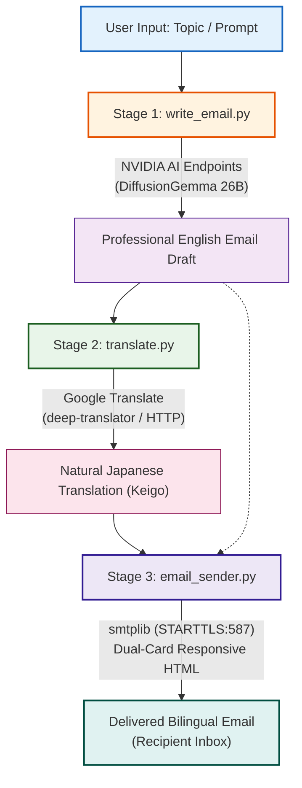

# 📧 English-to-Japanese Email Translator (Cloud AI + Google Translate Edition)

<p align="center">
  <a href="https://www.python.org/downloads/"></a>
  
  
  
</p>

> **A college minor project** combining cloud-hosted generative AI with high-speed neural translation — enter a simple topic prompt, generate a polished business email, translate it to natural Japanese, and dispatch a responsive bilingual email instantly.

---

## 📖 Overview

The **English-to-Japanese Email Translator** is an end-to-end cloud-native pipeline engineered to bridge international business communication. 

Unlike legacy machine learning workflows that demand multi-gigabyte model weights and heavy GPU libraries, this project implements a **lean, cloud-native architecture**:

1. **AI Email Drafting:** Generates formal, corporate English emails from brief user prompts using **NVIDIA AI Foundation Endpoints** (`google/diffusiongemma-26b-a4b-it` or `meta/llama-3.1-70b-instruct`) via LangChain with zero-dependency HTTP fallbacks.
2. **Deterministic Translation:** Translates English text to natural Japanese using **Google Translate** via `deep-translator` (backed by a native `urllib` HTTP fallback), delivering sub-second latency and consuming **0 LLM API tokens**.
3. **Bilingual Delivery:** Delivers a dual-language email with a responsive, styled HTML card layout (Japanese primary + English reference) and plain-text fallback via Python's built-in `smtplib` over TLS.
4. **Interactive Streamlit Web UI:** Provides a reactive browser interface (`app.py`) featuring **reactive auto-translation** (instant synchronization of Japanese subject & body upon editing English) and an **enhanced dry-run mode** (side-by-side sender and recipient validation without sending real emails).

---

## 🌟 Highlights & Key Advantages

| Feature | Description |
|---|---|
| 🚀 **Zero Local Model Download** | Eliminates all local checkpoint downloads (no 2.4 GB - 2.5 GB NLLB-200 weights or LLM parameter files). Clone and run immediately. |
| ⚡ **Zero GPU & PyTorch Requirement** | No CUDA, PyTorch (`torch`), or TorchVision requirements. Runs seamlessly on standard laptops, university lab computers, and cloud containers. |
| 🪶 **Ultra-Lightweight (<20 MB)** | The entire dependency tree installs in seconds and takes less than 20 MB of disk space (over **99.5% reduction** compared to >4.9 GB previously). |
| ⚡ **Lightning-Fast Execution** | Sub-second translation latency (~200–400 ms) via Google Translate paired with rapid cloud LLM streaming. |
| 🔄 **Reactive Auto-Translation** | Instant synchronization in the Streamlit UI: editing the English Subject Line (<kbd>Enter</kbd>) or English Email Draft (<kbd>Ctrl</kbd>+<kbd>Enter</kbd>) automatically triggers Google Translate synchronization for Japanese fields while preserving manual Japanese adjustments. |
| 🧪 **Provider-Independent Testing Architecture** | Comprehensive testing framework featuring **⚡ Automatic Dry-run with sending** (zero credentials, 2 temporary inboxes on the fly, real SMTP TLS handshake & delivery check) and **🧪 Manual Dry-run with sending** (any domain, disposable test SMTP relay, live web preview URL). |
| 🛡️ **Enhanced Dry-Run Mode** | Validates both Sender Email Address and Recipient Email Address side-by-side with full RFC regex checks, previewing the complete bilingual email without sending real emails. |
| 💰 **API Token & Quota Conservation** | LLM tokens are reserved solely for creative drafting; 100% of the translation workload is offloaded to Google Translate to preserve API quota. |
| 🐍 **100% Python 3.14.2 Compatible** | Built with pure-Python packages and standard library fallbacks (`urllib.request`), completely avoiding missing C++ binary wheel issues on newer Python releases. |
| 🛡️ **Graceful HTTP Fallbacks** | Both drafting and translation modules feature native Python standard library fallbacks that function even if third-party packages are absent. |

---

## 📊 Architecture Comparison: Legacy vs. Cloud Edition

| Metric / Dimension | Legacy Architecture (Local NLLB + PyTorch) | Cloud AI + Google Translate Edition | Benefit |
|---|---|---|---|
| **Total Disk Footprint** | **> 4,900 MB (4.9 GB+)** | **< 20 MB** | **> 99.5% space saved** |
| **Python 3.14.2 Support** | ❌ Broken (Missing C++ wheels / MSVC errors) | ✅ **100% Compatible (Pure Python)** | **Future-proof & portable** |
| **Setup & Install Time** | 20–45 minutes | **< 5 seconds** | **Instant onboarding** |
| **Hardware Requirement** | 4–8 GB GPU VRAM / 16 GB System RAM | **Basic CPU (<100 MB RAM)** | **Runs on any device** |
| **Translation Engine** | Local `facebook/nllb-200` Seq2Seq | **Google Translate (`deep-translator` / HTTP)** | **Higher speed & fluency** |
| **Translation Latency** | 3.0 – 8.0 seconds | **200 – 400 milliseconds** | **10–20× faster** |
| **API Quota Efficiency** | High consumption (LLM used for both) | **Optimal (0 LLM tokens for translation)** | **Preserves free API tier** |

---

## 🛠️ Tech Stack

```
┌────────────────────────────────────────────────────────────────────────┐
│                        English-to-Japanese Email Translator            │
├──────────────────────┬─────────────────────────────────────────────────┤
│ LLM Composition      │ NVIDIA AI Foundation Endpoints                  │
│                      │ • Model: google/diffusiongemma-26b-a4b-it       │
│                      │ • Fallback: meta/llama-3.1-70b-instruct         │
├──────────────────────┼─────────────────────────────────────────────────┤
│ LLM Framework        │ LangChain (`langchain-core`,                    │
│                      │ `langchain-nvidia-ai-endpoints`) + HTTP API     │
├──────────────────────┼─────────────────────────────────────────────────┤
│ Translation Engine   │ Google Translate (`deep-translator` + HTTP)     │
├──────────────────────┼─────────────────────────────────────────────────┤
│ Email Delivery       │ Python Standard Library `smtplib` + `email.mime`│
├──────────────────────┼─────────────────────────────────────────────────┤
│ Configuration        │ `python-dotenv` (.env secrets management)       │
├──────────────────────┼─────────────────────────────────────────────────┤
│ Runtime Compatibility│ Python 3.10, 3.11, 3.12, 3.13, 3.14.2           │
└──────────────────────┴─────────────────────────────────────────────────┘
```

---

## 📁 Project Structure

```
email translator/
├── email_trans/
│   ├── __init__.py           # Package initializer
│   ├── write_email.py        # Stage 1 — AI email drafting (NVIDIA AI Endpoints / DiffusionGemma)
│   ├── translate.py          # Stage 2 — Translation (Google Translate / deep-translator)
│   ├── email_sender.py       # Stage 3 — SMTP delivery (plain-text + dual-card HTML)
│   └── main.py               # CLI Orchestrator & interactive runner
├── app.py                    # Streamlit Web Application (Reactive UI, live preview & dry-run validation)
├── .env                      # 🔑 Environment secrets (API keys & SMTP credentials)
├── .env.example              # Template for environment configuration
├── requirements.txt          # Pure-Python dependencies (<20 MB)
├── README.md                 # Project overview and documentation (this file)
├── REQUIREMENTS.md           # Requirements and architecture specification
├── RULES.md                  # Development guidelines and coding standards
├── SETUP.md                  # Step-by-step installation and setup guide
├── SKILLS.md                 # Technical competencies matrix
├── PRD.md                    # Product Requirements Document
├── ACTION PLAN.md            # Project roadmap and milestone tracking
├── LEARNINGS.md              # Engineering insights and academic takeaways
└── WALKTHROUGH.md            # Detailed code and architectural walkthrough
```

---

## 🗺️ Pipeline Workflow



---

## ⚙️ Installation & Setup

### 1. Prerequisites
- **Python:** Python 3.10 – 3.14.2 installed on your system. Confirm with:
  ```bash
  python --version
  ```
- **Git:** Standard git client.

### 2. Clone the Repository
```bash
git clone <repository-url>
cd "email translator"
```

### 3. Create & Activate Virtual Environment

```bash
# Create virtual environment
python -m venv venv

# Activate — Windows PowerShell:
.\venv\Scripts\Activate.ps1

# Activate — Windows Command Prompt:
.\venv\Scripts\activate.bat

# Activate — macOS / Linux:
source venv/bin/activate
```

### 4. Install Dependencies

Install the lightweight, pure-Python dependencies (<20 MB, zero GPU / C++ compilation):

```bash
pip install -r requirements.txt
```

#### Content of `requirements.txt`:
```txt
deep-translator>=1.11.4
python-dotenv>=1.0.0
requests>=2.31.0
langchain-core>=0.1.30
langchain-nvidia-ai-endpoints>=0.1.0
```

> [!TIP]
> **Zero-Dependency Mode:** In offline or highly restricted Python 3.14.2 environments, the core functionality can operate entirely using Python's standard library (`urllib.request`, `json`, `smtplib`), as both `write_email.py` and `translate.py` include built-in standard library fallbacks!

---

## 🔑 Environment Configuration (`.env`)

Create a `.env` file in the project root:

```bash
# Copy example configuration template
cp .env.example .env
```

Populate the `.env` file with your credentials:

```dotenv
# ─── NVIDIA AI Endpoints ───────────────────────────────────────────────────
# Get your free key at: https://build.nvidia.com/
NVIDIA_API_KEY=nvapi-xxxxxxxxxxxxxxxxxxxxxxxxxxxxxxxxxxxxxxxxxxxxxxxxxxxxxxxxxxxx

# Optional: Override base URL or model
NVIDIA_BASE_URL=https://integrate.api.nvidia.com/v1
NVIDIA_MODEL=google/diffusiongemma-26b-a4b-it

# ─── Gmail SMTP Credentials ────────────────────────────────────────────────
# Full Gmail address
SENDER_EMAIL=your_email@gmail.com

# 16-character Gmail App Password (generated via Google Account Security)
SENDER_APP_PASSWORD=xxxx xxxx xxxx xxxx

# ─── Default Recipient ─────────────────────────────────────────────────────
RECIPIENT_EMAIL=recipient@example.com
```

> [!IMPORTANT]
> **Gmail App Password Setup:**
> 1. Visit [Google Account Security](https://myaccount.google.com/security) and ensure **2-Step Verification** is enabled.
> 2. Go to [Google App Passwords](https://myaccount.google.com/apppasswords).
> 3. Generate an App Password named `EmailTranslator`.
> 4. Copy the generated 16-character string into `SENDER_APP_PASSWORD`. Never use your personal account password.

> [!CAUTION]
> The deprecated variable `MODEL_PATH` is no longer needed and should not be used.

---

## 🚀 Quickstart & Usage

### 1. Launch the Streamlit Web Application (Recommended)

Launch the interactive, browser-based bilingual email dashboard:

```bash
streamlit run app.py
```

The Web UI provides a reactive, real-time environment with live visual feedback:

#### ✨ Key Streamlit Features:
- **Dual Composition Modes:**
  - **Mode A (AI Compose & Translate):** Type a topic or click quick-preset chips (*Milestone Completed*, *Reschedule Meeting*, *Delivery Update*, *Partnership Proposal*) to generate a full formal business email via NVIDIA AI and translate it to Japanese.
  - **Mode B (Direct Translate):** Directly type or paste existing English text or subject lines to translate immediately via Google Translate (bypassing LLM generation with 0 token cost).
- **🔄 Reactive Auto-Translation Synchronization:**
  - **Subject Line Reactive Sync:** Editing the **English Subject Line** and pressing <kbd>Enter</kbd> automatically triggers Google Translate synchronization for the **Japanese Subject Line (件名)**, applying corporate brackets (`【件名】...`).
  - **Email Draft Reactive Sync:** Editing the **English Email Draft** and pressing <kbd>Ctrl</kbd>+<kbd>Enter</kbd> (or clicking outside) automatically re-translates and synchronizes the **Japanese Email Body** in real time.
  - **State-Preserving Manual Adjustments:** Direct manual edits made to Japanese fields (*Japanese Subject Line* or *Japanese Translation Body*) are strictly preserved. The system will not overwrite your custom Japanese phrasing unless the corresponding English text is subsequently edited.
  - **On-Demand Re-translate:** A manual `🔄 Re-translate to Japanese` button is also provided for instant full-text re-synchronization.
- **🧪 Enhanced Dry-Run Mode (End-to-End Self-Verification):**
  - **Side-by-Side Address Verification:** Allows entering and validating both the **Sender Email Address** and **Recipient Email Address** side-by-side in balanced columns.
  - **Strict RFC Format Validation:** Validates both email formats using RFC-compliant pattern checks before proceeding, flagging invalid syntax early.
  - **Zero-Risk Safe Testing:** Simulates the entire dispatch lifecycle—assembles the resolved subject header, renders the responsive HTML dual-card email preview, and confirms validation status—**without sending real emails** over the network and without consuming Gmail SMTP quotas.
- **👁️ Live Dual-Card HTML Email Preview:**
  - Renders the exact email design seen by the recipient (Primary Rose card `#d63384` for Japanese + Reference Amber card `#856404` for English).
- **📨 Flexible Subject Dispatch Selector:**
  - Radio toggle to dispatch with:
    1. **Bilingual:** `【Japanese Subject】 English Subject` (standard business protocol)
    2. **Japanese Only:** `【Japanese Subject】`
    3. **English Only:** `English Subject`

---

### 2. Run the Complete Pipeline via CLI Orchestrator

Run the end-to-end translation pipeline with interactive preview, provider-independent test runs, or full delivery:

```bash
# ⚡ Automatic Dry-run with sending (zero credentials, 2 temporary inboxes on the fly, real SMTP TLS delivery verification):
python email_trans/main.py --topic "Project update" --auto-test

# 🧪 Manual Dry-run with sending (provider-independent from any corporate/custom domain via disposable test SMTP relay with live web preview):
python email_trans/main.py --topic "Project update" --manual-test --from dev@company.com --to client@domain.jp

# Dry-run preview (generates & translates without network SMTP transmission):
python email_trans/main.py --topic "inform client that project milestone 1 is complete" --dry-run

# Complete production execution with Gmail SMTP delivery:
python email_trans/main.py --topic "requesting meeting regarding Q3 financial review" --to "client@company.jp"

# Interactive mode (prompts for topic, recipient, and send confirmation):
python email_trans/main.py
```

---

### 3. 🧪 Provider-Independent Testing Architecture

To enable friction-free development, CI/CD verification, and academic demonstrations without credential barriers, the system features a **Provider-Independent Testing Architecture** that tests real email dispatch without requiring personal Gmail accounts or Google App Passwords:

```
┌────────────────────────────────────────────────────────────────────────────────────────┐
│                        PROVIDER-INDEPENDENT TESTING ARCHITECTURE                       │
├──────────────────────────────────────────┬─────────────────────────────────────────────┤
│ ⚡ Automatic Dry-Run with Sending         │ 🧪 Manual Dry-Run with Sending              │
│ • CLI: `--auto-test`                     │ • CLI: `--manual-test`                      │
│ • 100% automated end-to-end self-test    │ • Any sender domain (corporate, custom,     │
│ • Provisions 2 temporary inboxes on the  │   Outlook, Yahoo, etc. — no Gmail required) │
│   fly (sender & recipient)               │ • Dispatches via disposable test SMTP relay │
│ • Verifies real SMTP TLS handshake,      │   without needing Gmail App Passwords       │
│   dual-card MIME rendering & delivery    │ • Generates live web preview URL of the     │
│ • ZERO credentials required              │   delivered bilingual email                 │
└──────────────────────────────────────────┴─────────────────────────────────────────────┘
```

#### 🧪 Manual Dry-run with sending
- **Completely Free from Any Specific Mail Provider:** The sender identity is not restricted to Gmail. You can specify any address—such as corporate (`dev@company.com`), custom domains (`engineer@startup.io`), Outlook, or Yahoo.
- **Disposable Test SMTP Relay:** Dispatches via a disposable test SMTP relay without needing Gmail App Passwords or 2-Step Verification setups.
- **Live Web Preview of Delivered Email:** Generates an immediate, clickable web preview URL displaying the delivered bilingual email with dual-card HTML formatting (Rose Japanese primary card + Amber English reference card).
- **CLI Example:**
  ```bash
  python email_trans/main.py --topic "Project update" --manual-test --from dev@company.com --to client@domain.jp
  ```

#### ⚡ Automatic Dry-run with sending
- **100% Automated End-to-End Self-Test:** Runs completely autonomously with a single command—ideal for quick verification, CI/CD pipelines, and project demonstrations.
- **Provisions 2 Temporary Inboxes on the Fly:** Dynamically provisions two temporary inboxes in real time (one acting as the sender, one as the recipient).
- **Verifies Real SMTP TLS Handshake & Dual-Card MIME Delivery:** Establishes a real network connection over TLS, constructs the multipart MIME payload, verifies dual-card HTML template rendering, and validates inbox delivery confirmation.
- **Zero Credentials Required:** Completely functional without `.env` configuration, requiring zero API keys or SMTP passwords.
- **CLI Example:**
  ```bash
  python email_trans/main.py --topic "Project update" --auto-test
  ```

---

### 4. Run Individual Modules Separately

Each stage is completely modular and can be tested independently:

#### Stage 1: AI Email Generation
```bash
python email_trans/write_email.py
```
*Generates a professional corporate English email from a specified topic using NVIDIA DiffusionGemma.*

#### Stage 2: English-to-Japanese Translation
```bash
python email_trans/translate.py
```
*Translates English text into natural, polite Japanese (*Keigo*) via Google Translate (`deep-translator` with HTTP fallback).*

#### Stage 3: Email Dispatcher
```bash
python email_trans/email_sender.py
```
*Dispatches the bilingual email via Gmail SMTP with dual-card HTML formatting.*

---

## 💌 Responsive Bilingual Email Layout

Emails sent through the pipeline are delivered in `multipart/alternative` format containing:
1. **Plain-Text Alternative:** Clean ASCII formatted text for text-only clients.
2. **Responsive Dual-Card HTML:**
   - 🌸 **Top Card (Japanese):** Primary translation formatted with soft rose accent (`#d63384`) and high-readability Japanese typography.
   - 📜 **Bottom Card (English):** Original English draft formatted with a warm amber card (`#fff3cd`) for reference and auditability.
   - 🛡️ **Footer:** Polite notice that translation was automatically generated.

---

## 🐍 Python 3.14.2 Compatibility Notes

Python 3.14 introduced significant internal changes to CPython's C-API and internals. Traditional ML packages (`torch`, `sentencepiece`, `sacremoses`) fail to install on Python 3.14 due to missing binary wheels and compilation errors.

This project achieves full compatibility through:
- **Pure Python Packages:** Packages like `deep-translator` and `python-dotenv` are distributed as universal wheels (`py3-none-any`).
- **RESTful Cloud AI:** All heavy computation is executed on cloud infrastructure via standard HTTPS requests.
- **Built-in Fallbacks:** Both `write_email.py` and `translate.py` can operate using Python's standard library alone (`urllib.request`).

---

## 📄 License & Academic Attribution

This project is developed as a **College Minor Project** for academic evaluation:
- **Repository:** [vkhere/college-minor-project-01](https://github.com/vkhere/college-minor-project-01)
- **License:** MIT License

<p align="center">Made with ❤️ for Academic & Engineering Excellence</p>
